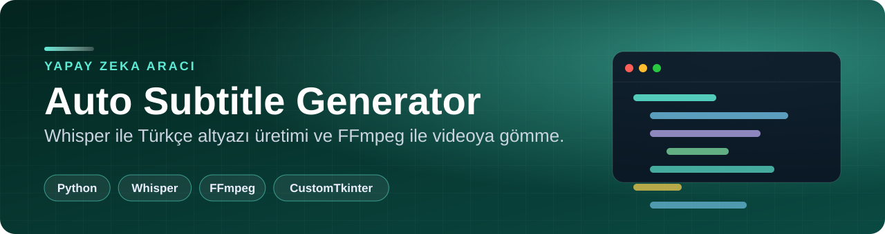

<div align="center">



# Auto Subtitle Generator

**OpenAI Whisper ile Türkçe altyazı üretir, FFmpeg ile videoya gömer.**


</div>

## Ne Yapar?

Bir videoyu seçersiniz; araç konuşmayı Whisper ile metne çevirip zaman damgalı bir `.srt` dosyası üretir ve FFmpeg ile bu altyazıyı videoya kalıcı olarak gömer (hardsub). Hem grafik arayüzle hem de komut satırıyla çalışır.

## Özellikler

- **Türkçe konuşma tanıma:** Whisper, Türkçe (`tr`) dil modunda çalışır
- **Model seçimi:** Arayüzden `base`, `small`, `medium` veya `large` (varsayılan `medium`); büyük modeller daha doğru, ancak daha fazla bellek ister
- **GPU desteği:** CUDA destekli ekran kartı varsa otomatik kullanılır, yoksa işlemci
- **Çıktılar:** `subtitle.srt` ve altyazısı gömülü `video_with_subs.mp4`
- **Arayüz:** CustomTkinter ile koyu temalı, işlem günlüğü gösteren masaüstü arayüz
- **Komut satırı modu:** `main.py` içindeki ayarlarla betik olarak çalıştırma

## Gereksinimler

- Python 3
- [FFmpeg](https://ffmpeg.org/download.html): `PATH` içinde erişilebilir olmalı
- İsteğe bağlı: CUDA destekli ekran kartı (işlemi hızlandırır)

## Kurulum

```bash
git clone https://github.com/yusufgunduz-dev/auto-subtitle-generator.git
cd auto-subtitle-generator

python -m venv venv
venv\Scripts\activate        # macOS ve Linux: source venv/bin/activate

pip install -r requirements.txt
```

## Kullanım

**Grafik arayüz**

```bash
python gui.py
```

Videoyu seçin, model boyutunu belirleyin ve **İŞLEMİ BAŞLAT** düğmesine basın.

**Komut satırı**

`main.py` dosyasının başındaki ayarları düzenleyin:

```python
INPUT_VIDEO = "video.mp4"
MODEL_SIZE  = "medium"   # tiny, base, small, medium, large
```

```bash
python main.py
```

## Proje Yapısı

```
gui.py              Grafik arayüz
main.py             Komut satırı betiği
requirements.txt    openai-whisper, torch, numpy, customtkinter
```

## Lisans

[MIT](LICENSE)

---

<sub>Geliştirici: [Yusuf Gündüz](https://github.com/yusufgunduz-dev) · [Revolasoft](https://revolasoft.com)</sub>
